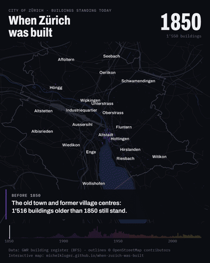

# When Zürich Was Built

Every building standing in the city of Zürich, drawn as its real outline and coloured by the year it was finished, from the medieval old town to 2026.

<p align="center"></p>

**Live page:** https://michelkluger.github.io/when-zurich-was-built/

Of the 45,646 buildings matched, 12,059 date from 1919–1945, more than any other era, and the busiest single year on the map is 1931. Since 2011 new buildings average 5.1 floors, the highest of any era since the 1850–1918 city blocks (5.4).

The page has a timeline you can play or scrub, a switch that raises every building by its floor count, an era filter and a five-stop tour of the old town, the 1850–1918 blocks, the post-war estates, Zürich-West and Hirzenbach.

## How it works

1. `scripts/download.sh` fetches the public GWR extract for Canton Zürich (Federal Statistical Office) and, through the Overpass API, the OpenStreetMap building outlines and map context (water, roads, rail, neighbourhood names, city boundary).
2. `scripts/prep_city.js` converts the outlines to Swiss LV95 coordinates, gives each outline the year built and floors of the register entries inside it (the largest entry sets the year), and writes `docs/city.txt` (packed binary, base64) and `docs/city_ctx.json`.
3. `docs/index.html` is the interactive page (deck.gl from a CDN, no build step).
4. `scripts/export.py` + `scripts/encode.py` render the 27-second video card (`src/video.html`) frame by frame with Playwright and encode a 1080×1350 MP4 (4:5, for social feeds) and the GIF above.

```sh
sh scripts/download.sh
node scripts/prep_city.js data/gebaeude_batiment_edificio.csv data/osm_buildings.json data/osm_context.json docs

# optional: video export (Edge with GPU WebGL via Direct3D, so Windows; GL=swiftshader for software rendering, ~45x slower;
# PW_CHANNEL=chrome or "" for bundled Chromium)
for k in 0 1 2 3; do uv run --with playwright python scripts/export.py frames $k 4 & done; wait
uv run --with imageio-ffmpeg python scripts/encode.py frames out/when-zurich-was-built
```

`scripts/prep_gwr.js` packs the register for the whole canton. It was used for early sketches and isn't needed for the page.

## Caveats

- Only buildings standing today. A demolished building has no outline, so each site shows only what stands there now, and older eras look smaller than they were.
- 4,469 OSM outlines (9%) had no register entry inside them or within 3 m and are left out.
- Floors are today's count. In the 3D view a building is floors × 3.2 m tall; the video exaggerates heights 5× so they read at city scale.
- Coordinates are converted with swisstopo's approximate formulas (about 1 m accuracy).

## Data

- Federal Register of Buildings and Dwellings (GWR): [public extract](https://www.housing-stat.ch/) for Canton Zürich, Federal Statistical Office, exported 3 November 2026.
- Building outlines and map context: © [OpenStreetMap](https://www.openstreetmap.org/copyright) contributors, ODbL. `docs/city.txt` and `docs/city_ctx.json` are derived from OSM and are shared under the ODbL.

Code is MIT licensed. Data remains under its providers' terms.
